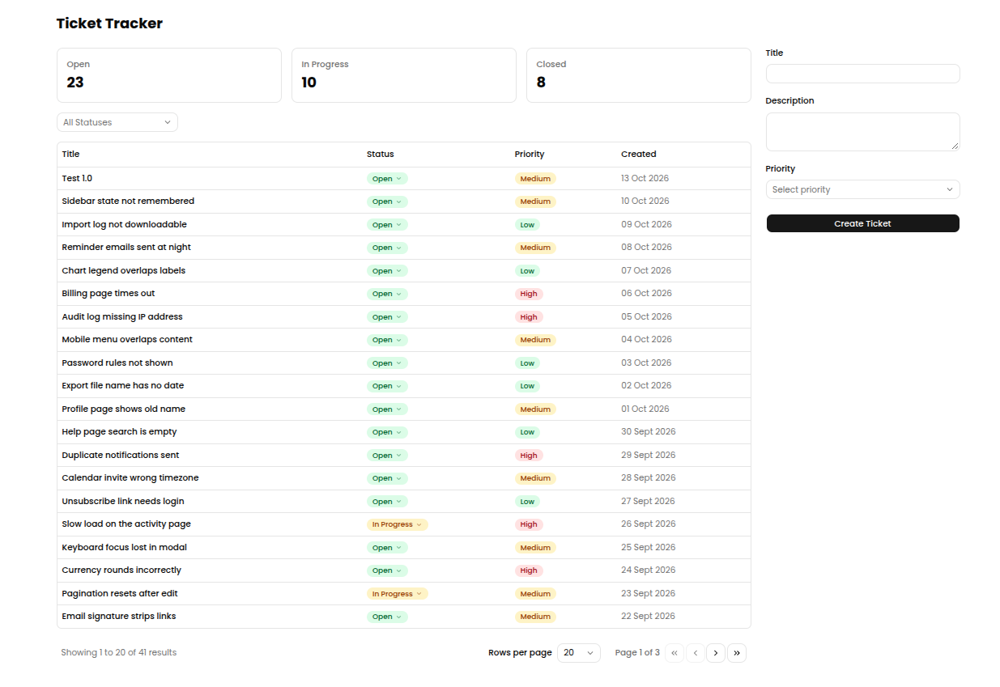

# Support Ticket Tracker

## Overview

This repository holds the support ticket tracker, a web application that records support tickets. The tracker has two parts: a frontend that shows the tickets in a web browser, and a backend that stores and serves them.



## Prerequisites

- Docker 23 or later, with Docker Compose version 2 (the `docker compose` command).
- Internet access on the first build, for Docker Hub, Maven Central, the npm registry and Google Fonts.
- Ports 3000 and 8095 free on this computer.

## Run

```bash
docker compose up --build
```

Open http://localhost:3000. The application loads 40 sample tickets on first start. Stop it with `docker compose down`. Delete the stored tickets as well with `docker compose down -v`.

The [backend](backend/README.md) and the [frontend](frontend/README.md) each have a README with instructions to run them alone.

## Decisions and Tradeoffs

### Assumptions

- The API allows three status moves, OPEN to IN_PROGRESS, OPEN to CLOSED and IN_PROGRESS to CLOSED, and answers any other move with 409.
- A closed ticket is final, so the API rejects a priority change on it.
- The list sorts newest first, and page numbers start at 1.
- The application has no authentication.

### Shortcuts

- The frontend repeats the status rule to hide invalid moves, and the 409 response backs the copy up.
- The setup serves local use only, so it carries default credentials and no reverse proxy.
- The images float on minor version tags, and the frontend build downloads the Poppins font from Google Fonts.
- The commit history is built after the work, so it groups changes by area and does not record the order in which they were written.

### With more time

- The next steps are frontend tests, a composite index for the filtered list, pinned image digests and a locally served font.
- The API would also return the allowed next statuses, which removes the duplicated status rule.